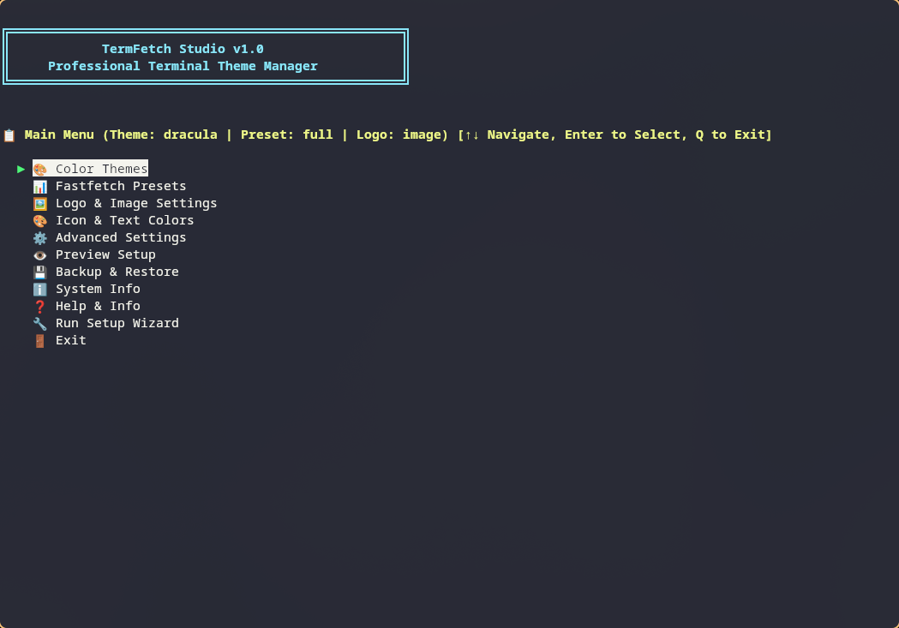
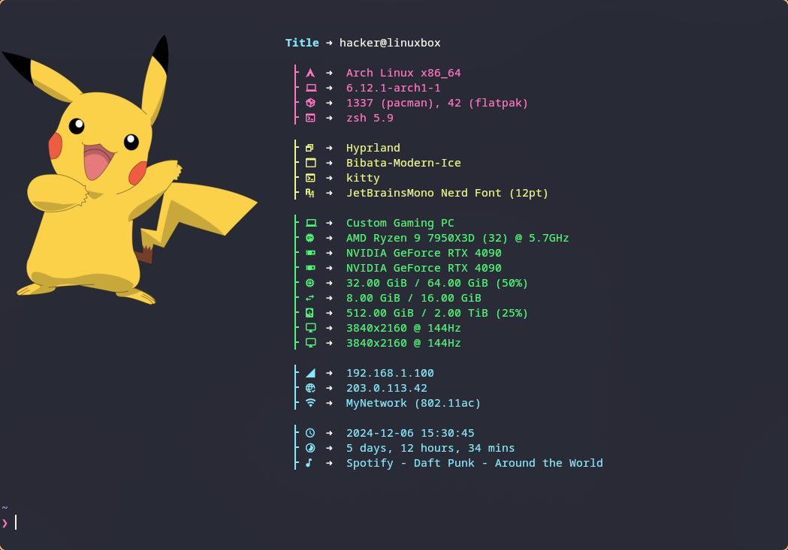

# TermFetch Studio

<div align="center">

```
╔═══════════════════════════════════════════════════╗
║         ████████╗███████╗██████╗ ███╗   ███╗      ║
║         ╚══██╔══╝██╔════╝██╔══██╗████╗ ████║      ║
║            ██║   █████╗  ██████╔╝██╔████╔██║      ║
║            ██║   ██╔══╝  ██╔══██╗██║╚██╔╝██║      ║
║            ██║   ███████╗██║  ██║██║ ╚═╝ ██║      ║
║            ╚═╝   ╚══════╝╚═╝  ╚═╝╚═╝     ╚═╝      ║
║                                                   ║
║      Professional Terminal Theme Manager          ║
╚═══════════════════════════════════════════════════╝
```

[](https://opensource.org/licenses/MIT)
[](https://github.com/sinansarikaya/termfetch-studio)
[](https://www.linux.org/)

Published release: [v1.0.0](https://github.com/sinansarikaya/termfetch-studio/releases/tag/v1.0.0). Current application version: 1.0.0. Installer fixes are tracked under [Unreleased](CHANGELOG.md).

**Transform your terminal into a beautiful, informative workspace**

[Features](#features) • [Installation](#installation) • [Usage](#usage) • [Themes](#themes) • [Screenshots](#screenshots)

</div>

---

## 📸 Preview

<div align="center">

### Interactive Menu


### Full Info Preset


</div>

---

## 🌟 Features

### 🎨 **Rich Theme Collection**
- **25 Built-in Themes**: Dark, Light, Colorful, Pastel, and Popular Culture options
- **8 Popular Themes**: Matrix 💚, Cyberpunk 🌆, Naruto 🍜, Pokemon ⚡, Spider-Man 🕷️, Doom 👹, Valorant 🔥, Minecraft ⛏️
- **3 Pastel Themes**: Sakura 🌸, Lavender Dream 💜, Candy 🍬
- **Custom Theme Creator**: Design your own color schemes
- **Persistent Colors**: Theme colors saved across terminal sessions
- **Live Preview**: See changes before applying

### 📊 **Fastfetch Integration**
- **5 Preset Configurations**: Full, Minimal, Focused, Developer, Gaming
- **🧩 Custom Preset Creator**: Build your own module combinations
- **🔄 Module Reordering**: Drag and drop style reordering with arrow keys
- **🎨 Advanced Color Customization**: Independent icon and text color control
- **🎯 Smart Color System**: Theme-based colors with custom override options
- **Clean Icon-Based Design**: Simple, elegant design with Nerd Font icons
- **Color-Coded Modules**: Each category has its own color for better readability
- **Tree-Style Layout**: Professional ├ └ tree characters for visual hierarchy
- **Beautiful Icons**: Every module has a matching Nerd Font icon

### 🖼️ **Advanced Logo System**
- **Multiple Logo Types**: Auto-detect distribution, custom images, ASCII art
- **Image Support**: PNG rendering verified in Kitty and Konsole VMs; WezTerm, iTerm2 and Foot still require real terminal validation
- **Format Conversion**: Auto-convert PNG, JPG, JPEG, GIF, BMP to optimal format with transparency preservation
- **Smart Resizing**: Automatically resize large images for better performance
- **ASCII Fallback**: Use a bundled text logo in unsupported terminals
- **16 Built-in ASCII Logos**:
  - Classics: Tux 🐧, Pikachu ⚡, Arch 📐
  - Cute: Cat 🐱, Neko 🎌, Bunny 🐰, Heart 💖, Sakura 🌸
  - Popular: Naruto 🍜, Pokeball ⚾, Spider 🕷️, Dragon 🐉, Creeper 💚, Star ⭐, Rocket 🚀

### 💾 **Backup & Restore**
- **Automatic Backups**: Before every change
- **Manual Backups**: Create anytime
- **Quick Restore**: Revert to any previous configuration
- **History Management**: Keep only recent backups

### ⚙️ **Smart Features**
- **Auto-Detection**: Identifies your terminal and capabilities
- **Setup Wizard**: Quick start for first-time users
- **Preview Mode**: Test configurations before applying
- **Shell Integration**: Bash, Zsh, Fish support
- **🛡️ Ubuntu Safety**: Automatic image logo blocking for unsupported terminals
- **🎭 Demo Mode**: Display fake system info for privacy-safe screenshots
- **🎨 Advanced Color Settings**: Customize every aspect of your fastfetch colors
- **📋 Interactive Guides**: Built-in help and navigation guides

---

## 📦 Installation

### Quick Install

```bash
git clone https://github.com/sinansarikaya/termfetch-studio.git
cd termfetch-studio
chmod +x install.sh
./install.sh
```

The installer will:
1. ✅ Check and install dependencies (fastfetch, optional tools)
2. ✅ Detect your distribution and terminal
3. ✅ Install themes and presets
4. ✅ Set up shell integration
5. ✅ Run the setup wizard

### Requirements

**Required:**
- Linux on a distribution tested below, or a compatible distribution with fastfetch already installed
- Bash and the standard command-line tools used by the installer (`tar`, `mktemp`, `sed`)
- Fastfetch >= 2.42.0 for RGB colors (installed by the installer on tested package-manager paths when missing)
- `sudo` and a working package manager when dependencies need installation; Debian/Ubuntu also need `curl` or `wget` for the pinned fastfetch package

On Debian-family systems, the installer downloads the official [fastfetch 2.53.0 release](https://github.com/fastfetch-cli/fastfetch/releases/tag/2.53.0) for x86_64 or aarch64 and verifies its SHA-256 checksum before installation. This fixed version was exercised on Ubuntu 24.04 and Debian 12/13 and avoids changes in a moving `latest` package. [Debian 13 also provides fastfetch 2.40.4](https://packages.debian.org/trixie/fastfetch); an already installed fastfetch is kept. This matrix tested the versions listed in the report; Debian’s 2.40.4 package is below the required 2.42.0 minimum and is rejected with an explicit message. Other architectures require fastfetch to be installed beforehand.

### Terminal menus and logo size

Menus use a compact title, separate icon/text columns and a single navigation
footer. Preview stays on the right from 110 terminal columns, moves below the
list in narrower windows, and is hidden below 16 rows. Selection survives resize.

Choose **Logo & Image Settings → Image Size → Small / Medium / Large** to save
an image-logo size. Medium now allows up to 36 columns and Large up to 52; all sizes preserve
aspect ratio and remain bounded by the current terminal. ASCII logos are unchanged.
Previews are prepared off screen before replacing the visible frame. See the
[latest preview/size regression evidence](tests/preview-fix-evidence/README.md) and
[current UI evidence and real Kitty screenshots](tests/ui-polish-evidence/README.md)
and the [earlier bug reproduction](tests/ui-evidence/README.md).

### Live icon and text colors

Open **Icon & Text Colors**. Use ↑↓ to select Icons/Text and ←→ to change the
color while watching the inline sample. **Save & Back** commits both fields;
**Q** cancels the draft. Theme/Default are available per field; Reset to Theme
resets the draft. The menu stays in one screen session while opening submenus.
See [current transition and live-color evidence](tests/live-colors-evidence/README.md).

### Compatibility evidence (x86_64)

The distribution table records the October 9 compatibility run. The October 22 UI
fix reran Ubuntu/Arch smoke scenarios and Arch/Kitty graphical checks; the
[UI report](tests/ui-evidence/README.md) records that narrower current scope.

Docker runs test dependency installation, application commands, settings,
backup/restore, reinstall, and uninstall with fastfetch both missing and
preinstalled. They **do not** verify a desktop session. Exact image digests,
fastfetch versions, and results are in [the test report](tests/REPORT.md).

| Distribution / version | Test type | Desktop / terminal | Result |
| --- | --- | --- | --- |
| Ubuntu 24.04 | Docker: fastfetch missing / preinstalled | No desktop / `TERM=dumb` | Passed / passed |
| Debian 12 | Docker: fastfetch missing / preinstalled | No desktop / `TERM=dumb` | Passed / passed |
| Debian 13 | Docker: fastfetch missing / preinstalled | No desktop / `TERM=dumb` | Passed / passed |
| Fedora 43 | Docker: fastfetch missing / preinstalled | No desktop / `TERM=dumb` | Passed / passed |
| Arch Linux rolling (`20261004.0.606936`) | Docker: fastfetch missing / preinstalled | No desktop / `TERM=dumb` | Passed / passed |
| openSUSE Tumbleweed (`20261007`) | Docker: fastfetch missing / preinstalled | No desktop / `TERM=dumb` | Passed / passed |
| Ubuntu 24.04.5 | QEMU VM: graphical checks | GNOME 46 Wayland / GNOME Terminal 3.52 + Kitty 0.32.2 | Passed for recorded checks; [screenshots](tests/screenshots/) |
| Debian 13.7 | QEMU VM: graphical checks | Plasma 6.3.6 Wayland / Konsole 25.04.2 + Kitty 0.41.1 | Passed for recorded checks; [screenshots](tests/screenshots/) |
| Fedora 43 | QEMU VM: graphical checks | GNOME 49 Wayland / GNOME Terminal 3.56.3 + Kitty 0.43.1 | Passed for recorded checks; [screenshots](tests/screenshots/) |
| Arch Linux rolling | QEMU VM: graphical checks | Hyprland 0.56.2 Wayland / Kitty 0.49.2 | Passed for recorded checks; [screenshots](tests/screenshots/) |
| openSUSE Tumbleweed 20261007 | QEMU VM: graphical checks | Plasma 6.7.5 Wayland / Konsole 26.08.1 + Kitty 0.48.2 | Recorded checks passed after guest terminal preparation; [report](tests/REPORT.md) |
| Ubuntu 24.04.5 | Separate QEMU X11 comparison | GNOME 46 X11 / GNOME Terminal + Kitty | Recorded checks passed; [screenshots](tests/screenshots/) |
| CachyOS rolling (user's computer) | Daily use reported by user | Hyprland Wayland; active terminal unconfirmed | Feature tests not claimed |

Other distribution IDs (including derivatives) and other versions are recognized by
family where possible but have not been tested here. A recognized package manager
does not guarantee that fastfetch is available in that release. A user-reported
daily-use CachyOS environment is recorded in the [manual checklist](tests/MANUAL_CHECKLIST.md),
without treating its features as tested.

**Optional (for enhanced features):**
- `chafa` - Image to ASCII conversion
- `jp2a` - JPEG to ASCII conversion
- `imagemagick` - Image processing

### Terminal behavior and graphical evidence

| Terminal | Runtime classification from session signals | Desktop status |
|----------|---------------------------------------------|----------------|
| Kitty | `kitty` → `kitty-direct` PNG | Verified in the VM combinations above; fixed dimensions may affect aspect ratio |
| Alacritty | `none` (ASCII) | Manual test pending |
| WezTerm | `wezterm` | Manual test pending |
| GNOME Terminal | `none` (ASCII) | Verified ASCII fallback in GNOME Wayland and Ubuntu X11 VMs |
| Konsole | `konsole` → `iterm` PNG | Verified in Debian/openSUSE KDE Wayland VMs |
| Foot | `foot` | Manual test pending |
| iTerm2 | `iterm2` | Manual test pending |
| xterm / st / unknown | `none` (ASCII) | xterm fallback verified in Debian VM; st/other terminals pending |

Graphical findings come from the listed VMs, separately from Docker. Remaining
combinations are in the [manual checklist](tests/MANUAL_CHECKLIST.md).

---

## 🚀 Usage

### Interactive Menu

Simply run:
```bash
termfetch-studio
```

**Navigation:**
- Use **↑** and **↓** arrow keys to navigate
- Press **Enter** to select
- Press **Q** to go back/quit
- Intuitive, kitty-themes style interface

Navigate through the intuitive menu to:
- 🎨 Choose and apply themes
- 📊 Configure fastfetch presets
- 🖼️ Set up logos and images
- ⚙️ Adjust advanced settings
- 👁️ Preview your setup
- 💾 Backup and restore

### Command Line Options

```bash
termfetch-studio [OPTIONS]

Options:
  -h, --help       Show help message
  -v, --version    Show version information
  --preview        Quick preview of current setup
  --backup         Create a backup
  --restore        Restore from backup
```

### Quick Examples

```bash
# Start interactive menu (with arrow key navigation)
termfetch-studio

# Preview current configuration
termfetch-studio --preview

# Create a backup before experimenting
termfetch-studio --backup

# Show help
termfetch-studio --help
```

### First Run

On first run, TermFetch Studio will:
1. **Detect** your terminal and capabilities
2. **Run** a setup wizard
3. **Guide** you through choosing your first theme
4. **Apply** your configuration automatically

---

## 🎨 Themes

### Dark Themes

<table>
<tr>
<td width="50%">

**🦇 Dracula**
```
A dark theme with vibrant colors
Perfect for: All-around use
```

</td>
<td width="50%">

**❄️ Nord**
```
Arctic, north-bluish color palette
Perfect for: Clean, minimal look
```

</td>
</tr>
<tr>
<td width="50%">

**🍂 Gruvbox Dark**
```
Retro groove warm color scheme
Perfect for: Long coding sessions
```

</td>
<td width="50%">

**🌃 Tokyo Night**
```
Clean, elegant dark theme
Perfect for: Modern aesthetics
```

</td>
</tr>
<tr>
<td width="50%">

**🌑 One Dark**
```
Atom's iconic dark theme
Perfect for: Developers
```

</td>
<td width="50%">

**🌊 Oceanic Next**
```
Ocean-inspired blue theme
Perfect for: Calm environment
```

</td>
</tr>
<tr>
<td width="50%">

**⚫ Monochrome**
```
Pure black & white minimalism
Perfect for: Distraction-free work
```

</td>
<td width="50%">
</td>
</tr>
</table>

### Light Themes

<table>
<tr>
<td width="50%">

**☀️ Gruvbox Light**
```
Warm retro light variant
Perfect for: Daytime coding
```

</td>
<td width="50%">

**🌅 Solarized Light**
```
Precision colors for readability
Perfect for: Extended reading
```

</td>
</tr>
<tr>
<td width="50%">

**🌞 One Light**
```
Atom's light theme
Perfect for: Bright environments
```

</td>
<td width="50%">

**🏖️ Ayu Light**
```
Simple, bright and elegant
Perfect for: Minimalists
```

</td>
</tr>
</table>

### Colorful Themes

<table>
<tr>
<td width="50%">

**🌈 Synthwave**
```
Retro-futuristic neon colors
Perfect for: Standing out
```

</td>
<td width="50%">

**🎨 Monokai Pro**
```
Professional color scheme
Perfect for: Developers
```

</td>
</tr>
<tr>
<td width="50%">

**🔮 Palenight**
```
Material design inspired
Perfect for: Modern UI lovers
```

</td>
<td width="50%">
</td>
</tr>
</table>

### Pastel & Cute Themes 💕

<table>
<tr>
<td width="50%">

**🌸 Sakura**
```
Cherry blossom pink theme
Perfect for: Kawaii aesthetics
```

</td>
<td width="50%">

**💜 Lavender Dream**
```
Soft purple lavender tones
Perfect for: Elegant & calm
```

</td>
</tr>
<tr>
<td width="50%">

**🍬 Candy**
```
Cotton candy pastel colors
Perfect for: Sweet & playful
```

</td>
<td width="50%">
</td>
</tr>
</table>

### Popular Culture Themes 🎮🎬

<table>
<tr>
<td width="50%">

**💚 Matrix**
```
Green on black hacker aesthetic
Perfect for: Coding like Neo
```

</td>
<td width="50%">

**🌆 Cyberpunk 2077**
```
Neon yellow and cyan futuristic
Perfect for: Night City vibes
```

</td>
</tr>
<tr>
<td width="50%">

**🍜 Naruto**
```
Orange and blue ninja theme
Perfect for: Anime fans
```

</td>
<td width="50%">

**⚡ Pokemon**
```
Bright yellow Pikachu colors
Perfect for: Gotta catch 'em all
```

</td>
</tr>
<tr>
<td width="50%">

**🕷️ Spider-Man**
```
Red and blue superhero theme
Perfect for: Marvel fans
```

</td>
<td width="50%">

**👹 Doom**
```
Red and orange hellfire
Perfect for: Demon slaying
```

</td>
</tr>
<tr>
<td width="50%">

**🔥 Valorant**
```
Red and green tactical colors
Perfect for: FPS gamers
```

</td>
<td width="50%">

**⛏️ Minecraft**
```
Grass green blocky aesthetics
Perfect for: Crafting adventures
```

</td>
</tr>
</table>

---

## 📊 Fastfetch Presets

All presets feature a **modern grouped design** with:
- 🎨 **Color-coded groups** for better organization
- 🌳 **Tree-style icons** (├ └) for visual hierarchy
- 🎯 **Logical grouping** of related information
- ✨ **Nerd Font icons** for every module

### 1. 📋 Full Info
Complete system information organized in 5 groups:
- **OS Group** (Red Icons): System, Kernel, Packages, Shell
- **WM Group** (Green Icons): Window Manager, Desktop, Theme, Terminal
- **PC Group** (Yellow Icons): CPU, GPU, Memory, Disk, Battery
- **NET Group** (Blue Icons): Local/Public IP
- **TIME Group** (Magenta Icons): DateTime, Media Player, Uptime
- **🎨 Smart Text Colors**: All text uses consistent theme-based colors for readability

**Best for:** System administrators, showing off your setup

### 2. 📝 Minimal
Essential information in 1 clean group:
- **OS Group** (Red): System, Kernel, Shell, Uptime

**Best for:** Quick glances, clean look, slow systems

### 3. 🎯 Focused
Balanced display with 3 key groups:
- **OS Group** (Red): System, Kernel, Packages, Uptime
- **WM Group** (Green): Terminal, Shell
- **PC Group** (Yellow): CPU, Memory, Disk

**Best for:** Daily use, balanced information

### 4. 💻 Developer
Development-focused with 4 groups:
- **OS Group** (Red): System, Kernel, Shell
- **WM Group** (Green): Terminal, Git branch
- **PC Group** (Yellow): CPU, Memory, Disk
- **NET Group** (Blue): Local/Public IP

**Best for:** Developers, programmers

### 5. 🎮 Gaming
Performance-focused with 3 groups:
- **OS Group** (Red): System, Kernel
- **PC Group** (Green): CPU, GPU, Memory, Resolution, Swap, Battery
- **NET Group** (Yellow): Local IP

**Best for:** Gamers, performance monitoring

### 6. 🧩 Custom Preset
Create your own module combinations:
- **Choose any modules** from 25+ available options
- **Reorder modules** with drag-and-drop style interface
- **Custom colors** for keys, values, titles, and underlines
- **Live preview** of your custom configuration

**Best for:** Personal preferences, unique setups

---

## 🎨 Advanced Color Customization

### Color Settings Menu
Access through: `⚙️ Advanced Settings → 🎨 Color Settings`

**Available Color Categories:**
- **🔑 Icon Color (keyColor)**: Colors for module icons (OS, Kernel, etc.)
- **📝 Text Color (outputColor)**: Colors for the actual information text
- **🏷️ Title Color**: Colors for the main title/header
- **📏 Underline Color**: Colors for the separator line

**Color Modes:**
- **🎨 Theme Colors**: Automatic color selection based on current theme
- **🎯 Custom Colors**: Manual color selection for complete control
- **🔄 Smart Switching**: Easy toggle between theme and custom modes

**Color Options:**
- Blue, Red, Green, Yellow, Magenta, Cyan, White, Black
- Bright variants: Bright Blue, Bright Red, etc.
- Default option for value colors

**Features:**
- **🎨 Live Preview**: See changes before applying
- **🔄 Reset to Default**: One-click restore to theme colors
- **⚡ Auto-Apply**: Changes apply immediately
- **🎯 Independent Control**: Icon and text colors can be set separately

---

## 🎭 Demo Mode

Demo Mode displays fake system information instead of real data - perfect for taking screenshots for GitHub, Reddit, or other platforms without exposing your actual system details.

### Enabling Demo Mode

1. **Navigate to Settings**:
   - Main Menu → `⚙️ Advanced Settings`

2. **Toggle Demo Mode**:
   - Select `🎭 Demo Mode: ❌ Off`
   - The toggle will switch to `✅ On`

3. **Preview Your Setup**:
   ```bash
   termfetch-studio --preview
   ```

### Demo Values Displayed

When Demo Mode is enabled, the following fake values are shown:

| Module | Demo Value |
|--------|------------|
| Title | `hacker@linuxbox` |
| OS | `Arch Linux x86_64` |
| Kernel | `6.12.1-arch1-1` |
| CPU | `AMD Ryzen 9 7950X3D (32) @ 5.7GHz` |
| GPU | `NVIDIA GeForce RTX 4090` |
| Memory | `32.00 GiB / 64.00 GiB (50%)` |
| Disk | `512.00 GiB / 2.00 TiB (25%)` |
| Local IP | `192.168.1.100` |
| Public IP | `203.0.113.42` |
| Uptime | `5 days, 12 hours, 34 mins` |
| WM | `Hyprland` |
| Terminal | `kitty` |
| Shell | `fish 3.7.0` |

### Supported Presets

Demo Mode works with the following presets:
- ✅ Full Info
- ✅ Minimal
- ✅ Focused
- ✅ Developer
- ✅ Gaming

> **Note:** Custom Preset currently doesn't support Demo Mode due to its dynamic module structure.

---

## 🧩 Custom Preset System

### Creating Custom Presets

1. **Navigate to Custom Preset**:
   - Main Menu → `📊 Fastfetch Presets` → `🧩 Custom Preset`

2. **Select Modules**:
   - Use **↑↓** arrow keys to navigate
   - Press **ENTER** to toggle selection
   - **✓** = Selected, **✗** = Not selected

3. **Reorder Modules**:
   - Press **R** to enter reorder mode
   - Use **←→** to select item to move
   - Use **↑↓** to move selected item
   - Press **ENTER** to save new order

4. **Save Configuration**:
   - Press **S** to save your custom preset
   - Press **Q** to quit without saving

### Available Modules

**System Information:**
- Operating System, Kernel, Packages, Shell
- Window Manager, Desktop Environment, WM Theme
- Icon Theme, Cursor Theme, Terminal, Terminal Font

**Hardware Information:**
- Host, CPU, GPU, Memory, Swap, Disk, Battery, Display

**Network Information:**
- Local IP, Public IP, WiFi

**Time Information:**
- Date & Time, Uptime, Media Player

### Reorder Mode Guide

```
📋 REORDER GUIDE:
  [←→] Select item to move
  [↑↓] Move selected item up/down
  [ENTER] Save new order
  [Q] Cancel and exit
```

**Tips:**
- Select the item you want to move with **←→**
- Move it up/down with **↑↓**
- The order you create is the order fastfetch will display
- You can reorder as many times as you want

---

## 🖼️ Screenshots

### Interactive Menu


*The main menu with arrow key navigation and live preview*

### Full Info Preset


*Complete system information with color-coded groups*

### Custom Setups

Share your custom configurations! Open a PR with your setup.

---

## 🖼️ Adding Custom Images

### Prerequisites

For the best experience with custom images, you need:

1. **Terminal with image support**: Kitty, WezTerm, iTerm2, or Foot
2. **ImageMagick** (optional, for format conversion and resizing):
   ```bash
   # Arch/Manjaro
   sudo pacman -S imagemagick

   # Debian/Ubuntu
   sudo apt install imagemagick

   # Fedora
   sudo dnf install ImageMagick
   ```

### How to Add an Image

1. **Launch TermFetch Studio**:
   ```bash
   termfetch-studio
   ```

2. **Navigate to Logo Settings**:
   - Select `🖼️ Logo & Image Settings`
   - Choose `🖼️ Custom Image`

3. **Enter your image path**:
   ```bash
   /path/to/your/image.png
   ```

### Supported Image Formats

- ✅ **PNG** (recommended, best performance)
- ✅ **JPG/JPEG** (auto-converted to PNG)
- ✅ **GIF** (auto-converted to PNG)
- ✅ **BMP** (auto-converted to PNG)

### Image Optimization

TermFetch Studio automatically:
- **Converts** non-PNG formats to PNG for optimal performance
- **Resizes** images larger than 1000px width to 800px
- **Copies** processed images to `~/.config/termfetch-studio/images/`

### Tips for Best Results

1. **Image Size**: Use images around 500-800px for best display
2. **Aspect Ratio**: Square or portrait orientation works best
3. **File Location**: Keep original images in a permanent location
4. **Transparency**: PNG with transparency looks great with most themes

### Terminal-Specific Notes

#### Kitty
- Best overall support
- Use `type: "kitty"` protocol
- Supports all image formats

#### WezTerm
- Good support with recent versions
- Use PNG for best compatibility

#### iTerm2 (macOS)
- Full support on macOS
- Inline image protocol

#### Foot
- Sixel protocol support
- May have limited color depth

#### Unsupported Terminals
- Falls back to ASCII art automatically
- Install `chafa` for better ASCII art conversion:
  ```bash
  sudo pacman -S chafa  # Arch
  sudo apt install chafa  # Ubuntu
  ```

---

## 🔧 Configuration

### Configuration File Location

```
~/.config/termfetch-studio/config.ini
```

### Manual Configuration

You can manually edit the configuration file:

```ini
[colors]
theme=dracula

[fastfetch]
preset=full
icons=true
logo_type=auto
custom_image=
logo_size=medium

[general]
first_run=false
backup_enabled=true
auto_backup=true

[advanced]
custom_colors=false
animation_enabled=true
preview_before_apply=true
```

### Custom Theme Format

Create your own theme file in `~/.config/termfetch-studio/themes/`:

```ini
# My Custom Theme
name=My Theme
type=dark
author=Your Name

# Background and Foreground
background=#1e1e1e
foreground=#d4d4d4

# Normal Colors (0-7)
color0=#1e1e1e
color1=#f44747
color2=#4ec9b0
color3=#ffcc66
color4=#569cd6
color5=#c586c0
color6=#4fc1ff
color7=#d4d4d4

# Bright Colors (8-15)
color8=#5a5a5a
color9=#f44747
color10=#4ec9b0
color11=#ffcc66
color12=#569cd6
color13=#c586c0
color14=#4fc1ff
color15=#ffffff
```

---

## 🆘 Troubleshooting

### Changes not persisting after terminal restart

Make sure fastfetch is enabled in your shell configuration:

```bash
# Check your shell config file
# For Bash:
nano ~/.bashrc

# For Zsh:
nano ~/.zshrc

# For Fish:
nano ~/.config/fish/config.fish

# Make sure this line is uncommented:
fastfetch
```

The installer automatically adds this, but it may be commented out. Simply remove the `#` to enable it.

### Fastfetch not found

The installer should handle this automatically, but if needed:

```bash
# Arch/Manjaro
sudo pacman -S fastfetch

# Debian/Ubuntu: the installer downloads and verifies fastfetch 2.53.0
# from the upstream release when it is absent.

# Fedora
sudo dnf install fastfetch

# On other distributions, install fastfetch through your distribution's
# package manager before running the installer.
```

### Menu navigation not working

If arrow keys don't work:
- Make sure your terminal supports ANSI escape sequences
- Try a different terminal emulator
- Check if `$TERM` is set correctly: `echo $TERM`

### Images not displaying

Check your terminal support:
```bash
termfetch-studio
# Go to: System Info → Check terminal capabilities
```

Supported terminals: Kitty, WezTerm, iTerm2, Foot

For others, use ASCII art fallback:
```bash
sudo pacman -S chafa jp2a  # or your package manager
```

### Colors not applying

1. Make sure you're using a compatible terminal
2. Try restarting your terminal
3. Check if your terminal supports truecolor:
```bash
echo $COLORTERM
# Should output: truecolor or 24bit
```

### Permission denied

Don't run the installer as root:
```bash
./install.sh  # Not: sudo ./install.sh
```

The installer will ask for sudo when needed.

### Emoji/Icons not showing

1. Install a Nerd Font or Font Awesome compatible font
2. Configure your terminal to use the font
3. Toggle icons in settings if needed

---

## 🗑️ Uninstallation

### Full Uninstall (removes everything)

```bash
sudo /usr/local/share/termfetch-studio/uninstall.sh
```

The uninstaller will ask if you want to keep your configuration files.

### Keep Configuration

If you want to reinstall later with your current settings:
- Answer "yes" when asked to keep configuration files
- Your themes and settings will be preserved

### Manual Cleanup

```bash
# Remove executable
sudo rm /usr/local/bin/termfetch-studio

# Remove installation directory
sudo rm -rf /usr/local/share/termfetch-studio

# Remove configuration (optional)
rm -rf ~/.config/termfetch-studio
```

---

## 🤝 Contributing

Contributions are welcome! Here's how you can help:

### Reporting Bugs

Open an issue with:
- Your distribution and version
- Terminal emulator and version
- Steps to reproduce
- Expected vs actual behavior

### Adding Themes

1. Create your theme file
2. Test it thoroughly
3. Submit a PR with:
   - Theme file
   - Screenshot
   - Description

### Feature Requests

Open an issue with:
- Feature description
- Use case
- Why it would be useful

### Code Contributions

1. Fork the repository
2. Create a feature branch
3. Make your changes
4. Test thoroughly
5. Submit a PR

---

## 📋 Roadmap

### Version 1.1 (Coming Soon)
- [ ] Theme store with community themes
- [ ] Logo pack downloads
- [ ] More fastfetch presets
- [ ] Terminal color scheme export
- [ ] GUI configuration editor

### Version 1.2
- [ ] Cloud backup sync
- [ ] Theme scheduling (day/night)
- [ ] Plugin system
- [ ] Advanced animation options

### Long-term
- [ ] Multi-monitor support
- [ ] Integration with other tools (neofetch, etc.)
- [ ] Mobile terminal support (Termux)
- [ ] Web-based theme editor

---

## 📜 License

This project is licensed under the MIT License - see the [LICENSE](LICENSE) file for details.

```
MIT License

Copyright (c) 2024 Sinan Sarıkaya

Permission is hereby granted, free of charge, to any person obtaining a copy
of this software and associated documentation files (the "Software"), to deal
in the Software without restriction, including without limitation the rights
to use, copy, modify, merge, publish, distribute, sublicense, and/or sell
copies of the Software, and to permit persons to whom the Software is
furnished to do so, subject to the following conditions:

The above copyright notice and this permission notice shall be included in all
copies or substantial portions of the Software.

THE SOFTWARE IS PROVIDED "AS IS", WITHOUT WARRANTY OF ANY KIND, EXPRESS OR
IMPLIED, INCLUDING BUT NOT LIMITED TO THE WARRANTIES OF MERCHANTABILITY,
FITNESS FOR A PARTICULAR PURPOSE AND NONINFRINGEMENT.
```

---

## 🙏 Acknowledgments

- **Fastfetch** - Fast system information tool
- **Dracula Theme** - Beautiful color scheme
- **Nord Theme** - Arctic color palette
- **Tokyo Night** - Clean dark theme
- All theme creators and contributors

---

## 📞 Contact & Support

- **GitHub**: [github.com/sinansarikaya/termfetch-studio](https://github.com/sinansarikaya/termfetch-studio)
- **Issues**: [Report a bug](https://github.com/sinansarikaya/termfetch-studio/issues)
- **Discussions**: [Community forum](https://github.com/sinansarikaya/termfetch-studio/discussions)

---

## ⭐ Star History

If you find this project useful, please consider giving it a star on GitHub!

---

<div align="center">

**Made with ❤️ by [Sinan Sarıkaya](https://github.com/sinansarikaya)**

*Transform your terminal, elevate your workflow*

</div>
