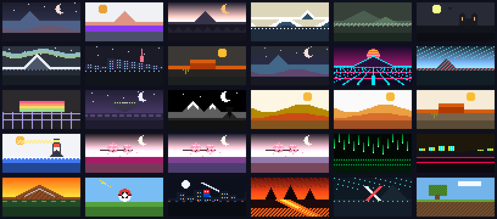

# TermFetch Studio v2 — UI/UX ve pixel art geliştirme raporu

Mevcut koyu stüdyo tasarımı, mor seçim vurguları, sol navigasyon ve üç sütunlu düzen korunarak tema görselleri ve ekran etkileşimleri geliştirildi.

## Önizlemeyi kullanma

- Normal düzende, 100 ve üzeri terminal sütununda önizleme sütunu toplam genişliğin %44'ünü alır. Çok geniş terminallerde önceki sabit üst sınır kaldırıldı.
- `f` veya önizleme başlığındaki `[⛶]` kontrolü, önizlemeyi mevcut gövde alanının tamamına genişletir. `Esc` veya tekrar `f` ile stüdyoya dönülür.
- Focus Preview içinde `↑/↓`, fare tekerleği ve `Page Up/Down` sistem bilgilerini kaydırır; `Home` başa döndürür.
- PNG dosyaları en-boy oranı korunarak ölçeklenir. Boyut hesabı sistem bilgilerine yer ayırır; uzun sistem değerleri, kesintisiz donanım kimlikleri ve Unicode metinler dahil, karakter kaybetmeden satıra sarılır.
- Fiziksel olarak tüm içeriği aynı anda sığdıramayan küçük terminallerde Focus Preview ve kaydırma kullanılır. 100 sütunun altında mevcut normal önizleme gizleme davranışı korunur; `f` burada da kullanılabilir.

## Tema seçme

- `Themes` ekranında `c` veya kategori satırına tıklama ile All, Dark, Light, Community, Pastel ve Gaming filtreleri arasında geçilir.
- `/` arama kutusunu açar. Metni yazıp `Enter` ile filtre uygulanır; `Esc` giriş işlemini iptal eder. Boş arama uygulamak metin filtresini temizler.
- Oklar filtrelenmiş sonuçlarda hareket eder; sonuç sayısı ve kaydırma filtreyle uyumludur. Boş sonuç kümesi güvenle görüntülenir.
- Kaydedilmiş tema `✓ applied` etiketiyle, önizleme için seçilen tema mor seçim çerçevesiyle gösterilir.
- Aynı çizim motoru Themes, Recent Themes ve mevcut sidebar thumbnail alanlarını besler.

## Pixel art sahneleri

Sahneler 64×32 mantıksal piksel üzerinde hesaplanır. Ölçekleme nearest-neighbor örneklemeyle, terminal çıktısı `▀` karakterinin ön/arka renkleriyle yapılır. Renkler temanın paletinden alınır; karakteristik öğelerde kontrollü tamamlayıcı renkler kullanılır. Harici görsel servisi veya ağ isteği gerekmez.

| Tema | Kompozisyon |
| --- | --- |
| Nord Aurora | Dalgalanan cyan/yeşil aurora, karlı zirve, yıldızlar |
| Catppuccin Mocha / Latte | Hilal, pastel katmanlı tepeler ve yıldızlar |
| Gruvbox Dark / Light | Basamaklı sıcak kanyon, çöl ve kehribar güneş |
| Tokyo Night / Cyberpunk | Neon pencereler ve farklı yüksekliklerde şehir silüeti |
| Monokai Pro / Synthwave '84 | Çizgili retro güneş, perspektif neon ızgara |
| One Dark | Karlı gece dağı, lacivert gökyüzü ve hilal |
| Rosé Pine | Şeftali tonlu gökyüzü ve katmanlı çam silüetleri |
| Everforest | Yeşil çam katmanları ve yatay sis şeritleri |
| Dracula | Kuleli gotik şato, aydınlık pencereler ve hilal |
| Solarized Light / Ayu Light | Açık çöl kumulları ve sabah güneşi |
| Kanagawa / Oceanic Next | Fuji benzeri zirve ve köpüklü piksel dalga |
| Sakura / Lavender / Candy | Çiçekli ağaç ve uçuşan taç yapraklar |
| Matrix | Yeşil dijital yağmur |
| Minecraft | Çimenli toprak blokları, blok ağaç ve bulutlar |
| Doom | Lav akıntıları ve karanlık kayalıklar |
| Monochrome | Kraterli ay yüzeyi |
| Material Palenight | Yüzen adalar ve hilal |
| One Light | Deniz, fener ve ışık huzmesi |
| Naruto / Pokémon / Valorant | Temaya özgü amblem kompozisyonları |
| Spider-Man | Kırmızı/mavi şehir silüeti |



Galeride soldan sağa, yukarıdan aşağıya sıra: Catppuccin Mocha, Catppuccin Latte, Rosé Pine, Kanagawa, Everforest, Dracula; Nord Aurora, Tokyo Night, Gruvbox Dark, One Dark, Synthwave, Oceanic Next; Monokai Pro, Palenight, Monochrome, Solarized Light, Ayu Light, Gruvbox Light; One Light, Sakura, Lavender, Candy, Matrix, Cyberpunk; Naruto, Pokémon, Spider-Man, Doom, Valorant, Minecraft.

Galeriyi yeniden üretmek için:

```bash
cargo run --example theme_gallery -- docs/ui-theme-gallery.png
```

## Diğer ekranlardaki değişiklikler

- **Dashboard:** Aktif tema, preset ve fastfetch durumu karşılama satırında görünür. Quick Action kartları standart alanda dört sütun, dar orta alanda 2×2 yerleşir. Dört kartın fare tıklamaları ile `1–4` davranışı eşleştirildi. Recent Themes çizim alanı büyütüldü. System Overview'a CPU, GPU, Memory ve Display satırları eklenerek boş alan değerlendirildi.
- **Presets:** Seçimin açıklaması, modül listesi ve modül sayısı orta sütunun detay kartındadır. Detay alanı ekran yüksekliğine uyarlanır. `Enter` kullanır/uygular; `d` kopyalar; `r` ad düzenler; `x` silme diyaloğunu açar. Silmek için `yes` yazıp `Enter` gerekir; `Esc` iptal eder. Hazır presetlerin adlandırılması ve silinmesi de desteklenir. En az bir preset bırakılır.
- **Preset kalıcılığı:** Kütüphane `~/.config/termfetch-studio/presets.json` dosyasında atomik yazılır. CLI ve TUI aynı kütüphaneyi okur. Önceki yalnızca kullanıcı kopyalarını içeren liste biçimi de okunabilir. Module Builder'da yapılan yeni düzenlemeler gerektiğinde `custom` presetini yeniden oluşturur.
- **Logos:** Distro ASCII, Custom ASCII ve PNG/Image grupları açık adlandırıldı. Kullanıcının UTF-8 `.txt` veya `.ascii` dosyaları `~/.config/termfetch-studio/ascii/` klasöründen alfabetik sırada yüklenir. Bu klasör, uygulamanın ürettiği logo dosyalarından ayrıdır. Mevcut `s` ile Small/Medium/Large seçimi ve oran koruması sürer.
- **Modules:** Enabled ve Available grupları, `Space` ile aç/kapa, `J/K` veya `Shift+↑/↓` ile sıralama korunur.
- **Settings:** Colors, Terminal, Preview, Shell Integration, Appearance ve Advanced grupları bulunur. Advanced altında Doctor ve Backup ekranlarına çalışan bağlantılar eklendi. Mevcut ayarlar ve renk override davranışı korunur.
- **Yardım:** Yeni kısayollar yardım penceresine ve ilgili ekranların alt çubuğuna eklendi.

## Değişen dosyalar

- `src/tui/widgets/ui.rs`: Sabit dağ kompozisyonunun yerine temaya özgü deterministik pixel art motoru.
- `src/tui/widgets/preview.rs`: Bilgi sütununa göre oran koruyan PNG boyutu, kayıpsız metin sarma ve kaydırmalı çizim.
- `src/tui/render.rs`: %44 önizleme oranı, Focus Preview, fare kontrolü, giriş/onay diyaloğu ve yardım metinleri.
- `src/tui/screens/dashboard.rs`: Uyarlanır Quick Actions, durum satırı, daha büyük recent görselleri ve genişletilmiş sistem özeti.
- `src/tui/screens/themes.rs`: Kategori/arama kontrolleri, filtrelenmiş kart ızgarası, büyük görseller ve applied etiketi.
- `src/tui/screens/presets.rs`: Uyarlanır detay kartı, modül sayısı ve işlem kısayolları.
- `src/tui/screens/settings.rs`: Ayar kategorileri ve Advanced bağlantıları.
- `src/app/actions.rs`: Focus Preview, filtreleme, arama ve metin girişi eylemleri.
- `src/app/state.rs`: Filtre, diyalog ve önizleme durumu; filtreli indeksler ve ortak preset yükleme.
- `src/app/reducer.rs`: Klavye/fare davranışları, onaylı silme, kopyalama, yeniden adlandırma ve kalıcı kütüphane yazımı.
- `src/domain/preset.rs`: Kalıcı preset kütüphanesini yükleme ve eski dosya biçimini okuma.
- `src/domain/logo.rs`: Özel ASCII dosyası keşfi ve kategori adları.
- `src/domain/theme.rs`: Nord Aurora görüntü adı.
- `src/main.rs`: Yeni kısayollar, diyalog metin girişi ve CLI/TUI ortak preset kütüphanesi.
- `tests/tui_render_tests.rs`: Focus Preview, filtreleme, preset kalıcılığı/silme onayı, thumbnail determinismi, özel ASCII ve Quick Action davranış testleri.
- `examples/theme_gallery.rs`: Gerçek thumbnail motorundan PNG galeri üretimi.
- `docs/ui-theme-gallery.png`: Görsel inceleme için üretilen galeri.
- Bu rapor: Kullanım, değişiklik ve doğrulama kaydı.

## Doğrulama ve kurulum

- `cargo test`: **60 başarılı, 0 başarısız, 0 atlanan** test. Dağılım: 30 birim, 2 CLI, 6 config, 3 kontrast, 7 tema ve 12 TUI davranış testi.
- Kontrast testleri 30 temayı, iki chrome seçeneğini, tüm ekranları ve odak bölgelerini tarar.
- TUI testleri standart, kompakt ve çok küçük terminal ölçülerini; PNG decode/Kitty yükleme akışlarını; filtre ve silme onayını kapsar.
- Metin sarma testi uzun kesintisiz tanımlayıcıların ve geniş Unicode karakterlerin kaybolmadığını denetler.
- `cargo build --release`: başarılı.
- `cargo run --example theme_gallery -- docs/ui-theme-gallery.png`: başarılı; galeri görsel olarak incelendi.
- `git diff --check`: başarılı.
- Kurulum: `/home/sinan/.local/bin/termfetch-studio` (755).
- Kurulu binary sürüm kontrolü: `termfetch-studio 2.0.0`.
- Release ve kurulu binary SHA-256: `8936eae5ac3e6b2df2b5e6daee551887c7f814f5245e59f9a67a1d7da1c7e336`.

Test ve derleme çıktıları [validation.txt](validation.txt) dosyasında saklanmıştır. Terminal etkileşimleri otomatik TestBackend üzerinden doğrulandı; gerçek terminal emülatöründe manuel bir kullanım oturumu yapılmadı.

| Kanıt | Bulgusu | İlgili uygulama yolu |
| --- | --- | --- |
| Focus Preview genişleme/geri dönüş testi | Fare ile genişleme ve Esc ile aynı ölçülere dönüş | `src/tui/render.rs`, `src/app/reducer.rs` |
| Arama ve boş sonuç testi | Gezinme yalnızca filtrelenmiş sonuçları seçer | `src/tui/screens/themes.rs`, `src/app/state.rs` |
| Preset kalıcılık ve onay testleri | Kopyalama/ad değişimi diskte kalır; iptal edilen silme veri kaldırmaz | `src/domain/preset.rs`, `src/app/reducer.rs` |
| Deterministik thumbnail testi ve PNG galeri | 30 farklı temanın kararlı halfblock görüntüleri | `src/tui/widgets/ui.rs`, `examples/theme_gallery.rs` |
| Kurulu binary hash kontrolü | Kurulum release çıktısıyla aynıdır | `~/.local/bin/termfetch-studio` |
